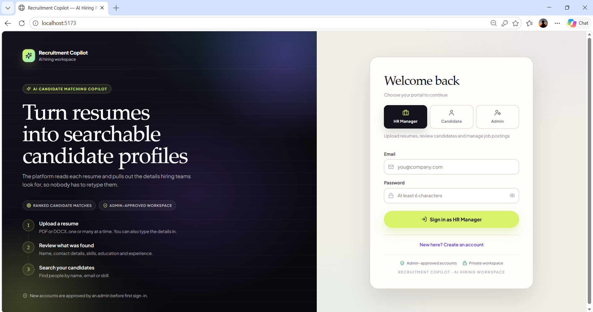
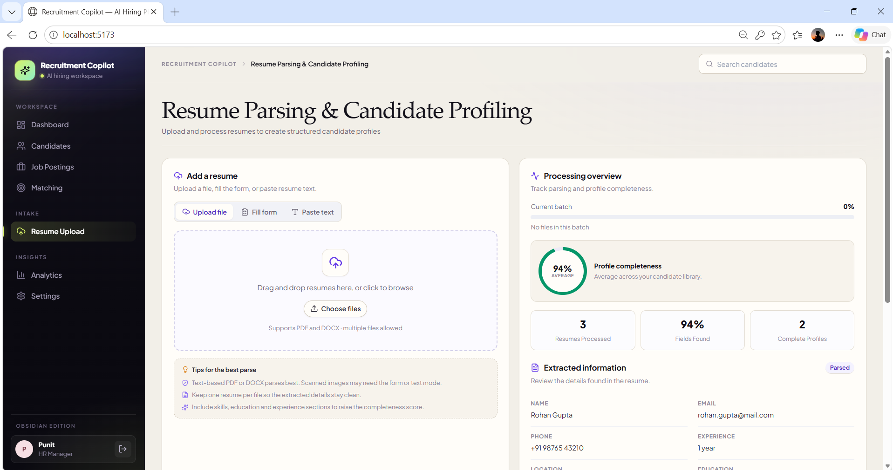

# AI-Driven Smart Hiring Platform with Candidate Matching Copilot

A web platform that reads candidate resumes (PDF and DOCX), extracts the key details, and saves them as structured candidate profiles. Recruiters, HR managers and candidates each get their own login portal.

> **Current status: Milestone 1 complete** (Resume Parsing and Candidate Profiling). Job description analysis, candidate matching, skill gap reports, interview tools and analytics are planned for the next milestones.

## Features

- Upload resumes in **PDF** and **DOCX** format, one or many at a time
- Automatic extraction of name, email, phone, location, education, experience, skills, projects and certifications
- Structured candidate profiles stored in **PostgreSQL**
- Dashboard with resumes processed, fields found, complete profiles and unique skills
- Candidate search by name, email or skill
- **Three login portals** with role-based access: Recruiter, HR Manager and Candidate
- Secure login with JWT tokens and hashed passwords

## Tech stack

| Layer | Technology |
|---|---|
| Frontend | React (Vite), lucide-react icons |
| Backend | FastAPI (Python) |
| Database | PostgreSQL with SQLAlchemy |
| Resume parsing | pdfplumber, python-docx, rules, spaCy, rapidfuzz, a 570+ skill list |
| Authentication | PyJWT, PBKDF2 password hashing |

## How it works

```
React website --> FastAPI backend --> Resume parser --> PostgreSQL
 (login, upload,    (login, upload,    PDF/DOCX reader, then      (candidates,
  dashboard)         candidates API)   contact, skills, education   users)
                                       and experience extraction
```

1. A user uploads a PDF or DOCX resume.
2. The text is extracted from the file.
3. Each field is found with rules: section headings, patterns for email and phone, date ranges for experience, and a skills list with more than 570 skills.
4. spaCy NER helps when the rules cannot find a name, a location or a college. rapidfuzz matches skills written in different ways, such as `MachineLearning`, `Scikit Learn` or `ML`.
5. The result is saved as a structured profile in the database.

Example profile returned as `candidate_profile`:

```json
{
  "candidate_id": "C001",
  "name": "John Doe",
  "email": "john@gmail.com",
  "phone": "9876543210",
  "skills": ["Python", "FastAPI", "SQL", "Docker"],
  "education": [{"degree": "B.Tech", "college": "VTU", "year": "2022"}],
  "experience_years": 3,
  "projects": ["AI Hiring System"],
  "certifications": ["AWS Practitioner"]
}
```

## User roles

| Portal | What they can do |
|---|---|
| Recruiter | Upload resumes, view and search candidates, delete candidates |
| HR Manager | View the dashboard and candidates (view only) |
| Candidate | Upload their own resume and see only their own parsed profile |

Access is checked in the backend on every request, not only hidden in the screen.

## Getting started

### Requirements

- Python 3.11 or newer
- Node.js 18 or newer
- PostgreSQL

### 1. Clone the project

```bash
git clone https://github.com/thepunitchaudhary/AI-Driven-Smart-Hiring-Platform-with-Candidate-Matching-Copilot.git
cd AI-Driven-Smart-Hiring-Platform-with-Candidate-Matching-Copilot
```

### 2. Create the database

In pgAdmin, create a database named `recruitment_db`. You can also run this in `psql`:

```sql
CREATE DATABASE recruitment_db;
```

The tables are created automatically the first time the backend starts.

### 3. Add your settings

Copy `.env.example` to `.env` and fill in your values:

```
DB_USER=postgres
DB_PASSWORD=your_postgres_password
DB_HOST=localhost
DB_PORT=5432
DB_NAME=recruitment_db
SECRET_KEY=put-a-long-random-text-here
```

`.env` is ignored by Git, so your password is never uploaded.

### 4. Start the backend

```bash
python -m venv myvenv
myvenv\Scripts\activate        # Windows
# source myvenv/bin/activate   # macOS / Linux
pip install -r requirements.txt
python -m spacy download en_core_web_sm
uvicorn main:app --reload
```

The API runs at `http://127.0.0.1:8000`. Interactive API docs are at `http://127.0.0.1:8000/docs`.

### 5. Start the frontend

Open a second terminal:

```bash
cd frontend
npm install
npm run dev
```

Open `http://localhost:5173`.

## Creating accounts

Open the login page, choose a portal (Recruiter, HR Manager or Candidate), click **New here? Create account**, and sign up with your name, email and a password of at least 6 characters. Then sign in with the same portal.

## API endpoints

| Method | Endpoint | Access |
|---|---|---|
| POST | `/api/register` | Public |
| POST | `/api/login` | Public |
| GET | `/api/me` | Any logged-in user |
| POST | `/api/upload_resume` | Any logged-in user |
| GET | `/api/candidates` | Recruiter, HR Manager |
| GET | `/api/stats` | Recruiter, HR Manager |
| GET | `/api/candidates/{id}/profile` | Recruiter, HR Manager |
| DELETE | `/api/candidates/{id}` | Recruiter |

## Project structure

```
.
├── main.py                  # FastAPI app and API routes
├── auth.py                  # Login, registration, roles, JWT tokens
├── queries.py               # Candidate list, stats, final profile JSON, delete
├── requirements.txt         # Python packages
├── .env.example             # Example settings (copy to .env)
├── parser/
│   ├── pdf_parser.py        # Reads text from PDF files
│   ├── docx_parser.py       # Reads text from DOCX files
│   └── resume_parser.py     # Combines all extractors into one profile
├── extraction/
│   ├── contact_extractor.py    # Name, email, phone, location
│   ├── skill_extractor.py      # Skill matching, aliases, fuzzy matching
│   ├── education_extractor.py  # Degree, college, year
│   ├── experience_extractor.py # Years of experience from dates
│   ├── section_extractor.py    # Finds Education, Skills, Projects sections
│   └── nlp_model.py            # Loads the spaCy model
├── database/
│   ├── db.py                # Database connection
│   └── models.py            # Candidate table and save function
├── skills/
│   └── skills.csv           # 570+ skills with aliases
├── dataset/                 # Sample resumes (not uploaded to Git)
├── uploads/                 # Resumes saved by the backend (not uploaded to Git)
└── frontend/                # React website
```

## Screenshots

Add your images to `docs/screenshots/` with these names.

| Login portals | Resume upload |
|---|---|
|  |  |

| Recruiter dashboard | Candidates list |
|---|---|
|  |  |

## Parser accuracy

The parser scored 100% on 70 generated PDF and DOCX test resumes with known correct answers, against the 95% target in the milestone. These test resumes are generated, so real resumes with unusual layouts may score lower. See `ACCURACY_REPORT.md` for the method and results.

## Known limits

- Rules do most of the work. spaCy is used as a fallback for names, locations and colleges, and it is not perfect.
- Fuzzy matching only fixes close spellings, not big typos.
- Resumes that contain no name return an empty name instead of a guess.
- Two-column PDF layouts can mix up the text order.

## Optional: pyresparser

pyresparser can be merged with the parser to fill in missing fields. It is off by default because it is an old library.

```bash
pip install pyresparser
python -m nltk.downloader stopwords punkt words averaged_perceptron_tagger maxent_ne_chunker
```

Then add `USE_PYRESPARSER=true` to your `.env` file.

## Roadmap

| Milestone | Scope | Status |
|---|---|---|
| 1 | Resume parsing and candidate profiling, login portals | Done |
| 2 | Job description analysis, candidate matching, skill gap analysis | Planned |
| 3 | Interview question generation, AI interview simulation | Planned |
| 4 | Voice screening, recruitment analytics dashboard, ATS integration | Planned |

## Author

Punit Kumar
